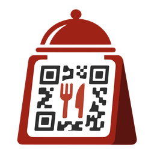

  

<h1 align="center">ROMA for desktop</h1>

  The point of sale for your restaurant or cafe, on Windows and Mac. 
  <a href="../../releases/latest"><strong>Download the latest version</strong></a>

---

ROMA desktop runs your counter: take orders, run tables, print bills and kitchen tickets, and see the
day's sales. It works with your ROMA account, so orders customers place by scanning a table's QR code
arrive on the counter as they happen.

## What you can do

- **Take orders fast.** Tap dishes and add-ons, keep several orders open at once, and send them to the
  kitchen with one click.
- **See every order live.** New, preparing and ready orders, with a sound when one arrives.
- **Run your tables.** See which tables are free, what each owes, and move or close them.
- **Print on your receipt printer.** Bills, kitchen tickets and table QR cards on 58 mm and 80 mm thermal
  printers, by USB, Bluetooth or the network.
- **Look after your menu.** Prices, photos, add-ons, sale prices and what's sold out, from the counter.
- **Know how the day went.** Sales, best sellers and customer ratings on the dashboard.
- **Give your staff their own sign-ins.** Each with just the permissions their role needs.

## Download

Get the installer for your computer from the [latest release](../../releases/latest):

| Computer | File |
| --- | --- |
| Windows 10 or 11 (64-bit) | `ROMA-Setup-<version>.exe` |
| Mac (Apple silicon or Intel) | `ROMA-<version>-mac-universal.dmg` |

ROMA keeps itself up to date: when a new version is out, it downloads in the background and asks
before restarting.

### Windows says "Windows protected your PC"

The Windows installer isn't code-signed yet, so SmartScreen may warn the first time. Choose
**More info**, then **Run anyway**.

## Need help?

Contact [Arsi Consultancy](https://github.com/arsi-consultancy).

This repository holds the downloads only; ROMA's source code is private.
